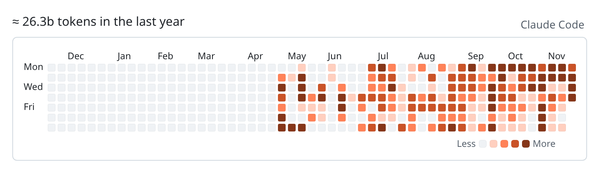

# panuska.dev

*Under observation, we act less free, which means we effectively are less free.*

 

  

<picture>
  <source media="(prefers-color-scheme: dark)" srcset="./profile/stats-dark.svg" />
  
</picture>
<picture>
  <source media="(prefers-color-scheme: dark)" srcset="./profile/top-langs-dark.svg" />
  
</picture>

Most of my work lives in private repositories. Stats include private contributions, refreshed daily.

<!-- claude-stats:start -->
<!-- claude-stats: generated by scripts/build-readme.mjs, do not edit by hand -->

<picture>
  <source media="(min-width: 1148px) and (prefers-color-scheme: dark)" srcset="claude-stats/contrib-dark.png">
  <source media="(min-width: 1148px) and (prefers-color-scheme: light)" srcset="claude-stats/contrib-light.png">
  <source media="(min-width: 1148px)" srcset="claude-stats/contrib-light.png">
  <source media="(min-width: 889px) and (prefers-color-scheme: dark)" srcset="claude-stats/contrib-38w-dark.png">
  <source media="(min-width: 889px) and (prefers-color-scheme: light)" srcset="claude-stats/contrib-38w-light.png">
  <source media="(min-width: 889px)" srcset="claude-stats/contrib-38w-light.png">
  <source media="(min-width: 768px) and (prefers-color-scheme: dark)" srcset="claude-stats/contrib-26w-dark.png">
  <source media="(min-width: 768px) and (prefers-color-scheme: light)" srcset="claude-stats/contrib-26w-light.png">
  <source media="(min-width: 768px)" srcset="claude-stats/contrib-26w-light.png">
  <source media="(min-width: 601px) and (prefers-color-scheme: dark)" srcset="claude-stats/contrib-38w-dark.png">
  <source media="(min-width: 601px) and (prefers-color-scheme: light)" srcset="claude-stats/contrib-38w-light.png">
  <source media="(min-width: 601px)" srcset="claude-stats/contrib-38w-light.png">
  <source media="(min-width: 458px) and (prefers-color-scheme: dark)" srcset="claude-stats/contrib-26w-dark.png">
  <source media="(min-width: 458px) and (prefers-color-scheme: light)" srcset="claude-stats/contrib-26w-light.png">
  <source media="(min-width: 458px)" srcset="claude-stats/contrib-26w-light.png">
  <source media="(prefers-color-scheme: dark)" srcset="claude-stats/contrib-17w-dark.png">
  <source media="(prefers-color-scheme: light)" srcset="claude-stats/contrib-17w-light.png">
  <source srcset="claude-stats/contrib-17w-light.png">
  
</picture>

**163&nbsp;active&nbsp;days** · longest&nbsp;streak&nbsp;**34&nbsp;days** · current&nbsp;streak&nbsp;**0&nbsp;days** · **≈&nbsp;$18.2k**&nbsp;in&nbsp;API&nbsp;prices*

* Tokens recomputed at Anthropic's public API list prices. Not an amount paid.

<!-- claude-stats:end -->

## Open source

| Project | |
|---|---|
| [macOS-Claude-Code-usage-widget](https://github.com/LiberaFatum/macOS-Claude-Code-usage-widget) | macOS menu bar widget showing Claude Code session and weekly rate limits and token usage |
| [macos-caffeinate-widget](https://github.com/LiberaFatum/macos-caffeinate-widget) | Menu bar toggle that keeps a Mac awake with the lid closed |
| [claude_code-collection](https://github.com/LiberaFatum/claude_code-collection) | Skills, rules, commands and CLAUDE.md files I created or curated |
| [claude-configuration](https://github.com/LiberaFatum/claude-configuration) | Portable Claude Code configuration for development teams |
