# panuska.dev

*Under observation, we act less free, which means we effectively are less free.*

 

  

<picture>
  <source media="(prefers-color-scheme: dark)" srcset="./profile/stats-dark.svg" />
  
</picture>
<picture>
  <source media="(prefers-color-scheme: dark)" srcset="./profile/top-langs-dark.svg" />
  
</picture>

Most of my work lives in private repositories. Stats include private contributions, refreshed daily.

## Open source

| Project | |
|---|---|
| [macOS-Claude-Code-usage-widget](https://github.com/LiberaFatum/macOS-Claude-Code-usage-widget) | macOS menu bar widget showing Claude Code session and weekly rate limits and token usage |
| [macos-caffeinate-widget](https://github.com/LiberaFatum/macos-caffeinate-widget) | Menu bar toggle that keeps a Mac awake with the lid closed |
| [claude_code-collection](https://github.com/LiberaFatum/claude_code-collection) | Skills, rules, commands and CLAUDE.md files I created or curated |
| [claude-configuration](https://github.com/LiberaFatum/claude-configuration) | Portable Claude Code configuration for development teams |
